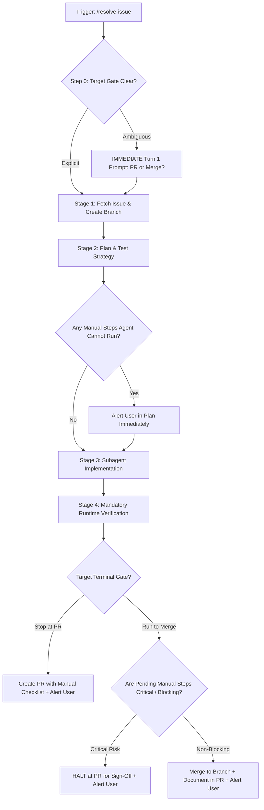

# Issue Resolution Workflow (`/resolve-issue`)

Autonomous, goal-driven orchestration workflow that drives a GitHub issue from initial intake to a verified, quality-gated delivery—terminating at either an inspected **Pull Request** or an autonomous **Merge**.

---

## Operating Architecture: The Architect / Subagent Pattern



### 1. High-Reasoning Architect
The primary agent acts as the **Lead Software Architect and Orchestrator**:
- Retains strategic context, architectural constraints, and git state.
- Immediately clarifies terminal gate (PR vs. Merge) upfront before context switching.
- Formulates implementation plans, identifies automated vs. manual test steps, and runs `/plan-review`.
- Verifies all diffs, runtime executions, and quality gates before any commit, PR, or merge.

### 2. Low-Reasoning Subagents
Implementation tasks are offloaded to **focused subagents** (using `flash` or `flash_lite` model tier):
- Assigned bounded, single-file or single-component objectives.
- Provided explicit file paths, replacement blocks, and test verification commands.
- Report completion directly back to the Architect without polluting parent context.

---

## Systematic Execution Stages

### Step 0: Immediate Terminal Gate Check (PR vs. Merge)
**Fast-Interruption Policy**:
Before diving into deep file audits, code edits, or subagent dispatching, determine the target delivery gate:
- **Stop at Pull Request (PR)**: Prepare changes, verify automated tests, open PR for human review.
- **Run to Merge**: Complete work, verify, open PR, and autonomously merge into integration branch (e.g. `dev`).

> [!IMPORTANT]
> If the user's intent is ambiguous (e.g., they asked to "fix #123" without specifying PR vs. Merge), **ask the user immediately on Turn 1** (via `ask_question`). Do this right away before the user stands up from their desk or switches screens.

---

### Stage 1: Intake & Trace Setup
1. **Fetch Issue Context:**
   ```powershell
   gh issue view <issue-id> --json title,body,labels,assignees,milestone
   ```
2. **Create Prefixed Branch:** Name branch using conventional prefix: `feat/<issue-id>-<slug>`, `fix/<issue-id>-<slug>`, or `chore/<issue-id>-<slug>`.
   ```powershell
   git checkout -b fix/<issue-id>-<slug>
   ```
3. **Initialize Feature Work Trace:**
   Create `/docs/traces/[branch-name]-work-trace.md` (or `docs/branch-notes/`). Populate planned objectives, target files, and rationale.

---

### Stage 2: Dynamic Skill Selection & Test Strategy in `/plan`
Analyze the issue requirements and dynamically activate the relevant specialized skills from the catalog (e.g., `/database-and-migrations-slim`, `/frontend-ui-engineering-slim`, `/security-and-hardening-slim`).

#### Mandatory Test Strategy Breakdown:
Every implementation plan MUST explicitly delineate:
1. **Automated Verification**: Specific commands the agent will run (e.g., unit tests, E2E specs, script execution, build checks).
2. **Expected Manual Steps**: Any steps that the agent **cannot** execute autonomously (e.g., Windows UAC elevation, physical mobile controller testing, interactive OAuth/SSO).
   - If manual steps exist, **alert the user immediately in the plan** so expectations are aligned before execution begins.

Audit and verify the plan using `/plan-review`.

---

### Stage 3: Subagent Execution & Implementation
1. Decompose the plan into independent implementation chunks.
2. Follow `/subagent-delegate-on-rails` for metacognitive decomposition, heuristic model tier selection (`flash` / `flash_lite`), and anti-chatter prompt rails.
3. Dispatch focused subagents (`Implementer`, `TestEngineer`, etc.) with Artifact + Contract only.
4. The Architect verifies and reconciles subagent output against the plan using doubt-driven classification.

---

### Stage 4: Comprehensive Runtime Verification & Quality Gate
> [!CAUTION]
> **Runtime Verification Mandate:** As established in the global `AGENTS.md` foundation mandates, static AST parsing, linter checks, or syntax validation alone are **strictly insufficient** to claim a script or feature works. Real execution in the runtime environment is required.

1. **Real Execution**:
   - For scripts: Execute the script in a test harness or dry-run and verify the actual exit code and console behavior.
   - For code: Run full automated test suites via `/testing-workflow` (100% pass rate required).
2. **Quality Gate Review**:
   - Audit surgical git diffs (`git diff`).
   - Run linter/compiler checks.
   - Verify SonarCloud quality gate compliance (0 new blocker/critical issues).
   - Execute specialized quality checks from dynamically selected skills (accessibility, security).

---

### Stage 5: Delivery & Termination Gate (PR vs. Merge Judgment)

#### Scenario A: Target Gate is "Pull Request (PR)"
1. Commit changes using Conventional Commits and Imperative Tense:
   ```powershell
   git commit -am "fix(scope): resolve issue description (#<issue-id>)"
   ```
2. Push branch and create Pull Request linking the issue and trace:
   ```powershell
   git push -u origin <branch-name>
   gh pr create --title "fix(scope): <title> (#<issue-id>)" --body "Closes #<issue-id>`n`n### Manual Verification Required`n- [ ] List any remaining manual steps"
   ```
3. If uncompleted manual steps remain, explicitly alert the user in chat.

#### Scenario B: Fast-Forward to PR (User asked to run straight to PR without planning turn)
- Complete all automatable implementation and verification steps.
- Compile the checklist of remaining manual steps that could not be verified autonomously.
- Open the PR with a dedicated `### Manual Verification Required` section in the PR description.
- Notify the user in chat of the completed automated work and the pending manual checks.

#### Scenario C: Target Gate is "Merge"
When commanded to run all the way through to merging, the Architect must apply high-reasoning risk evaluation:

1. **Evaluate Pending Manual Verification Risk**:
   - **Critical / Breaking Risk**: (e.g. database schema migrations without dry-run, breaking auth changes, destructive data operations, untested network port bindings).
     - **Action**: **HALT at Pull Request**. Do NOT merge into `dev`.
     - **Notification**: Alert user immediately in chat: *"Halted at PR #<id> prior to merge: Critical manual verification is required before this change can safely land on dev. Please review and sign off."*
   - **Non-Blocking / Low Risk**: (e.g. documentation updates, cosmetic tweaks, internal developer scripts with verified syntax and fallbacks).
     - **Action**: Proceed to merge into the integration branch (e.g. `dev`).
     - **PR Documentation**: Ensure the PR body documents the change and any post-merge verification recommendations.
     - **Notification**: Alert user in chat that the PR has been merged and summarize any recommended follow-up checks.
